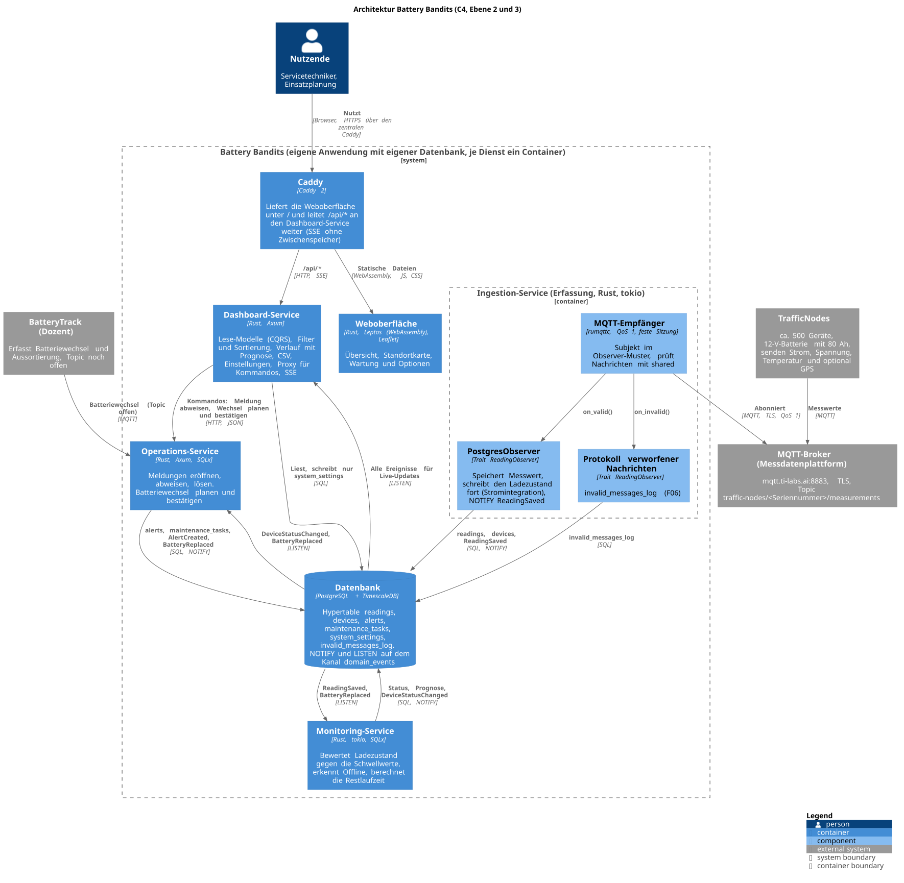

# Battery Bandits – TrafficNode Batterieüberwachung

> **Hinweis:** Dieses Projekt ist Teil der Lehrveranstaltung *Software Engineering I*, DHBW Stuttgart (TINF25D-KI)
> **Spezifikation v0.2.1**

<p align="center">
  
</p>

<p align="center">
  
</p>


---

## 1. Kontext

### a. Beschreibung

Ein Unternehmen betreibt mobile, batteriebetriebene Geräte (**TrafficNodes**) ohne eigene digitale Zustandsüberwachung. Schwache oder leere Batterien können zu Geräteausfällen und ungeplanten Serviceeinsätzen führen.

Eine nachrüstbare Telemetriebox (TrafficNode) erfasst Strom, Spannung und GPS-Position der Geräte und veröffentlicht die Messwerte auf einem MQTT-Broker. Hardware und Firmware der TrafficNode sind vorgegeben und nicht Teil dieses Projekts.

**Battery Bandits** empfängt die Batteriedaten ab dem MQTT-Broker, speichert sie und stellt sie in einem Dashboard dar. Das bringt zwei Vorteile:

- Der Batteriezustand lässt sich aus der Ferne beobachten und sein Verlauf nachvollziehen.
- Batteriewechsel werden rechtzeitig geplant, unnötige Wechsel vermieden.

Perspektivisch (Teil_B) sollen die gesammelten Daten außerdem darauf untersucht werden, ob sich geeignete Wechselzeitpunkte abschätzen lassen.

### b. Stakeholder

*Rollen und Interessen sind noch nicht mit dem Auftraggeber abgestimmt. Die folgende Einteilung ist ein erster Entwurf des Teams und muss verifiziert werden.*

| Stakeholder | Beschreibung | Ziel / Interesse |
|--------------|--------------|------------------|
| **Betreiber** | Unternehmen, das die TrafficNodes einsetzt | Batteriezustand überwachen, Serviceeinsätze planbar machen |
| **Servicetechniker** | Nutzende, die Batterien vor Ort wechseln | Wissen, welche Batterie wann fällig ist |
| **Betrieb / IT** | Betreibt die Software | Stabiler, wartbarer Betrieb |
| **Entwicklungsteam** | Battery Bandits | Klare, prüfbare Anforderungen |


## 2. Funktionale Anforderungen

Priorität: Hoch (Muss) · Mittel (Soll) · Niedrig (Kann)

| ID | Anforderung | Beschreibung | Priorität |
|----|-------------|--------------|-----------|
| F01 | **Datenempfang** | Das System empfängt Batteriemesswerte der TrafficNodes über den MQTT-Broker. | Hoch |
| F02 | **Datenspeicherung** | Jeder Messwert wird mit Geräte-ID, Zeitstempel und Ladestand gespeichert. | Hoch |
| F03 | **Geräteübersicht** | Nutzende sehen den aktuellen Batteriezustand aller Geräte. | Hoch |
| F04 | **Verlaufsansicht** | Nutzende sehen den Ladestand eines Geräts über einen wählbaren Zeitraum. | Hoch |
| F05 | **Kritisch-Markierung** | Geräte unter einem konfigurierbaren Schwellwert werden markiert. | Hoch |
| F06 | **Validierung** | Ungültige Nachrichten werden verworfen und protokolliert. | Hoch |
| F07 | **Offline-Erkennung** | Geräte ohne Daten seit einem konfigurierbaren Intervall werden erkannt. | Mittel |
| F08 | **Restlaufzeit-Prognose** | Das System schätzt die verbleibende Laufzeit anhand des Verlaufs. | Mittel |
| F09 | **Benachrichtigung** | Nutzende werden bei kritischem Zustand aktiv informiert (z. B. E-Mail). | Niedrig |
| F10 | **Login** | Zugriff auf das Dashboard nur für angemeldete Nutzende. | Niedrig |
| F11 | **Datenexport** | Nutzende können Messwerte/Verläufe als CSV oder Excel exportieren. | Mittel |
| F12 | **Standortanzeige** | Der zuletzt bekannte GPS-Standort eines Geräts wird angezeigt (z. B. Karte oder Standortliste). | Mittel |
| F13 | **Filter & Sortierung** | Die Geräteübersicht lässt sich nach Status, Standort und letztem Update filtern und sortieren. | Mittel |

Konkrete Prüfkriterien (Zahlenwerte für Zeit, Toleranzen etc.) sind noch nicht mit dem Auftraggeber abgestimmt und werden in A02 ergänzt.

---

## 3. Nicht-funktionale Anforderungen

| ID | Kategorie | Beschreibung | Priorität |
|----|-----------|--------------|-----------|
| NF01 | **Performance** | Ein neuer Messwert ist innerhalb von 30 Sekunden im Dashboard sichtbar. | Hoch |
| NF02 | **Skalierbarkeit** | Das System verarbeitet die Last einer mittleren Flotte von bis zu ca. 500 Geräten ohne Nachrichtenverlust. | Hoch |
| NF03 | **Zuverlässigkeit** | Verbindungsabbrüche zum Broker werden automatisch behoben, ohne feste Zeitvorgabe für die Wiederverbindung. | Mittel |
| NF04 | **Usability** | Kritische Geräte sind ohne Suche erkennbar. | Mittel |
| NF05 | **Testbarkeit** | Kernlogik ist automatisiert getestet; eine konkrete Ziel-Testabdeckung ist noch nicht festgelegt. | Hoch |
| NF06 | **Portabilität** | Das System ist per Container startbar. | Mittel |
| NF07 | **Wartbarkeit** | Schwellwerte und Intervalle sind ohne Codeänderung anpassbar. | Mittel |
| NF08 | **Datenhaltung** | Die Aufbewahrungsdauer der Messwerte richtet sich nach dem Bedarf des Auftraggebers und wird mit diesem festgelegt. | Mittel |
| NF09 | **Zugriffskontrolle** | Alle Nutzenden des Dashboards sind gleichberechtigt; es gibt keine unterschiedlichen Rollen oder Rechte. | Niedrig |

Weiterhin offen: konkrete Ziel-Testabdeckung (NF05) und die genaue Aufbewahrungsdauer (NF08) sind mit dem Auftraggeber abzustimmen (siehe Abschnitt 9).

---

## 4. Abgrenzung & MVP

Das Projekt wird **inkrementell** entwickelt. Ziel ist zunächst ein **MVP**, das den Kernnutzen demonstriert. Funktionen außerhalb des MVP werden als **Future Work** dokumentiert.

### Umfang des Projekts (umgesetzt)
- Datenempfang und -speicherung ab dem MQTT-Broker (F01, F02, F06)
- Geräteübersicht mit Kritisch-Markierung, Filter und Sortierung (F03, F05, F13)
- Verlaufsansicht pro Gerät (F04)
- Offline-Erkennung (F07) und Restlaufzeit-Prognose (F08)
- Datenexport als CSV (F11) und Standortkarte (F12)
- Meldungen und Batteriewechsel (planen, bestätigen)
- Eigener Testpublisher als Testdatenquelle (gemäß Aufgabenstellung ab A05 selbst zu entwickeln)

### Nicht umgesetzt (Future Work)
- Benachrichtigung (F09) und Login (F10)
- Tourenplanung oder Auftragsverwaltung für Techniker
- Anbindung der Batteriewechsel-Ereignisse von BatteryTrack (Topic noch offen)
- Native Mobile-App

### Außerhalb des Projekts
- Hardware, Sensorik und Firmware der TrafficNodes
- Betrieb und Konfiguration des MQTT-Brokers
- Überwachung anderer Gerätewerte als der Batterie

---

## 5. Dictionary / Gemeinsames Begriffsverzeichnis

Das Dictionary legt fest, was wir im Projekt unter einem Begriff verstehen. Die englischen Entsprechungen gelten für Bezeichnungen im Code, in Topics und APIs. Ein Glossareintrag erweitert nicht den MVP-Umfang.

| Bevorzugter Begriff | Englisch / Code | Definition im Projekt | Abgrenzung / alternative Bezeichnungen |
|--------------------|-----------------|-----------------------|---------------------------------------|
| **TrafficNode** | Node | Mobiles, batteriebetriebenes Gerät des Betreibers, das Messwerte sendet. | „Gerät" wird synonym verwendet. Hardware und Firmware liegen außerhalb des Projekts. |
| **Messwert** | Reading | Einzelne Meldung eines TrafficNodes mit Geräte-ID, Zeitstempel und Ladestand. | Nicht mit „Nachricht" gleichsetzen: eine ungültige Nachricht ergibt keinen Messwert. |
| **Nachricht** | Message | Rohdaten, die über MQTT empfangen werden. | Wird erst nach erfolgreicher Validierung zum Messwert. |
| **Ladestand** | State of Charge (SoC) | Verbleibende Batteriekapazität. | Ob Spannung, Strom oder Prozent übertragen wird, ist offen (Frage 2). |
| **MQTT-Broker** | Broker | Server, der MQTT-Nachrichten zwischen Sendern und Empfängern verteilt. | Systemgrenze: Wir nutzen den Broker, betreiben ihn aber nicht. |
| **Topic** | Topic | Adresse, unter der MQTT-Nachrichten veröffentlicht werden. | Struktur noch mit dem Auftraggeber zu klären (Frage 1). |
| **Schwellwert** | Threshold | Konfigurierbarer Ladestand, unter dem ein Gerät als kritisch gilt. | Wert und ggf. Gerätespezifik noch offen (Frage 4). |
| **Kritisch** | Critical | Zustand eines Geräts, dessen letzter Ladestand unter dem Schwellwert liegt. | Nicht gleich „offline". |
| **Offline** | Offline | Gerät hat länger als das definierte Intervall keinen Messwert gesendet. | Sagt nichts über den Ladestand aus. |
| **Verlauf** | History | Zeitliche Abfolge der Messwerte eines Geräts. | — |
| **Batteriewechsel** | Battery replacement | Serviceeinsatz zum Austausch der Batterie vor Ort. | Wird vom System nicht durchgeführt, nur vorbereitet. |
| **Standort** | Location | Zuletzt bekannte GPS-Position eines Geräts. | Wird zusammen mit dem Messwert übertragen; genaues Format offen (Frage 1). |
| **Export** | Export | Herunterladen von Messwerten/Verläufen als CSV oder Excel. | Bezieht sich auf bereits gespeicherte Daten, keine Echtzeit-Schnittstelle. |

### Pflege und offene Begriffsentscheidungen

- **Ein Begriff pro Bedeutung:** Synonyme zuordnen, unterschiedliche Konzepte getrennt benennen.
- **Unklarheiten früh erfassen:** Neue Begriffe vor der Umsetzung ergänzen und offene Definitionen markieren.
- **Änderungen gemeinsam prüfen:** Begriffsänderungen per Pull Request; betroffene Anforderungen, Tests und Code-Bezeichnungen mitprüfen.
- **Offene Punkte:** Einheit des Ladestands, Höhe des Schwellwerts, Länge des Offline-Intervalls.

---

## 6. Team & Organisation

**Teamname:** Battery Bandits
| Name | Matrikelnummer |
|------|----------------|
| Noah Boufercha | 1455982 |
| Fynn Becker | 3487242 |

---
## 7. Tools & Technologien

| Bereich | Entscheidung |
|---------|--------------|
| Architektur | Microservices nach dem Event Storming, je Dienst ein Container |
| Messaging | MQTT (gemeinsamer Broker der Messdatenplattform) von außen, PostgreSQL `NOTIFY` und `LISTEN` zwischen den Diensten |
| Backend | Rust mit tokio, rumqttc (MQTT-Empfang), Axum (HTTP) und SQLx |
| Frontend | Rust mit Leptos (WebAssembly, Trunk), Leaflet für die Karte |
| Codebasis | Ein Cargo-Workspace: `crates/shared`, `services/ingestion-service`, `monitoring-service`, `operations-service`, `dashboard-service`, `test-publisher` und `frontend` |
| Datenbank | PostgreSQL mit TimescaleDB, eine Instanz |
| Deployment | Docker Compose, Images mit cargo-chef, Caddy |


Ausführlich mit Begründungen: [docs/Architekturkonzept.md](docs/Architekturkonzept.md). Arbeitsgrundlage mit den Vorgaben aus Vorlesung und Server: [CLAUDE.md](CLAUDE.md).

### Architekturstil

- **Kontext:**
  - Das Event Storming schneidet das System in Erfassung, Überwachung, Meldungen und Einsatz und Dashboard
  - Last klein: ca. 1,7 Nachrichten/s, höchstens 20 Nutzende, kleines Team
  - Das Team möchte die fachlichen Schnitte als eigenständige Dienste umsetzen und die Architektur dabei bewusst üben
- **Entscheidung:**
  - Microservices, ein Dienst je Service aus dem Event Storming:
    - `ingestion-service` (Erfassung): MQTT empfangen, prüfen, speichern
    - `monitoring-service` (Überwachung): Status bewerten, Offline erkennen, Restlaufzeit prognostizieren
    - `operations-service` (Meldungen und Einsatz): Meldungen eröffnen, abweisen, lösen, Batteriewechsel planen und bestätigen
    - `dashboard-service` und `frontend` (Dashboard): lesende Sicht, Einstellungen, Echtzeit und Oberfläche
  - Dienste tauschen **Ereignisse** über Postgres `NOTIFY` und `LISTEN` aus (`ReadingSaved`, `DeviceStatusChanged`, `AlertCreated`, `BatteryReplaced`, JSON auf dem Kanal `domain_events`). Das Ereignis wird in derselben Transaktion wie die Datenänderung gesendet.
  - **Kommandos** (Meldung abweisen, Wechsel planen und bestätigen) gehen vom Dashboard-Service per HTTP an den zuständigen Dienst. Nur der Besitzer eines Datenbestands schreibt ihn.
  - Eine TimescaleDB-Instanz, Migrationen zentral in `migrations/`. Die Lesesicht des Dashboards ist ein bewusster Kompromiss: Eine eigene Kopie von 52 Mio. Messwerten wäre unverhältnismäßig.
- **Alternativen:**
  - *Modularer Monolith:* für diese Last ausreichend und einfacher zu betreiben. Das Team hat sich trotzdem für Microservices entschieden.
  - *NATS JetStream als Bus* (frühere Fassung): Ereignisse werden gespeichert, aber ein weiterer Baustein im Betrieb. Mit `NOTIFY` entfällt er.
  - *Kafka oder RabbitMQ:* für diese Größe überdimensioniert.
- **Konsequenzen:**
  - (+) Klare Grenzen entlang der Fachlichkeit, Dienste lassen sich einzeln ändern, starten und ersetzen
  - (+) Der Datenempfang läuft weiter, wenn Dashboard oder Überwachung neu starten (NF03)
  - (+) Weniger Betriebsaufwand als mit eigenem Bus: Datenbank, Broker (extern), vier Rust-Dienste, ein Webserver
  - (−) `NOTIFY` wird nicht gespeichert: Wer kurz nicht zuhört, verpasst Ereignisse. Monitoring und Operations gleichen deshalb beim Start und regelmäßig den Datenbestand ab
  - (−) Letztendliche Konsistenz: Zwischen Messwert und Meldung vergehen Millisekunden
  - (−) Tests über mehrere Dienste brauchen den ganzen Stack (`tools/smoke.sh`)

### Backend

- **Kontext:**
  - Dauerhafter MQTT-Empfang mit Prüfung und Speicherung
  - Datenversorgung des Dashboards
  - Langer Betrieb ohne Ausfälle, wartbar und testbar
  - Observer-Muster vorgegeben
- **Entscheidung:**
  - Rust, ein Cargo-Workspace, ein Prozess je Dienst
  - Empfangsdienst: tokio (async) und rumqttc (MQTT, QoS 1, feste Sitzung, Bestätigung nach der Verarbeitung, automatisches Wiederverbinden)
  - Dashboard-Service und Operations-Service: Axum, Live-Updates per Server-Sent Events
  - Datenbankzugriff: SQLx mit Migrationen, Tests gegen eine echte TimescaleDB
  - Observer-Muster im Empfangsdienst: Der `MqttReceiver` meldet über den Trait `ReadingObserver` an seine Beobachter, den `PostgresObserver` (speichern) und die Protokollierung verworfener Nachrichten
  - Kernlogik (Prüfen, Ladezustand, Prognose, Statusregeln) als reine Funktionen, ohne Datenbank und Netzwerk testbar
  - Ladezustand nach der Vorlesung: Integration des Stroms (Trapezregel), Nennkapazität 80 Ah, Startwert aus der Ruhespannung (Annahme)
- **Alternativen:**
  - *Actix Web:* sehr schnell, aber eigene Laufzeit-Konzepte
  - *Kotlin mit Spring Boot:* ausgereift, aber zweite Sprache neben dem Frontend, höherer Speicherbedarf
  - *Python mit FastAPI:* schneller Einstieg, aber dynamische Typen
- **Konsequenzen:**
  - (+) Speicher- und Thread-Sicherheit durch den Compiler
  - (+) Sehr geringer Ressourcenbedarf, kleine Container
  - (−) Steile Lernkurve (Ownership, Borrow Checker, async)
  - (−) Längere Kompilierzeiten

### Frontend

- **Kontext:**
  - Stark interaktives Dashboard (Filter, Suche, Diagramm, Live-Updates, Karte)
  - Nutzbar auf dem Handy
  - Neue Werte nach höchstens 10 Sekunden sichtbar
- **Entscheidung:**
  - Leptos als Single-Page-App, kompiliert zu WebAssembly, Build mit Trunk
  - Gemeinsame Datentypen mit dem Backend aus dem Paket `shared`
  - Minimales Design mit CSS-Variablen (hell und dunkel), drei Bereiche: Übersicht, Standortkarte, Wartung und Optionen
  - Verlaufsdiagramm als eigenes SVG (Geometrie als reine, getestete Funktion), Karte mit Leaflet über JavaScript-Interop (lokal eingebunden, Kacheln von OpenStreetMap)
  - Live-Updates per `EventSource`, gedrosseltes Nachladen alle 2 Sekunden
- **Alternativen:**
  - *Dioxus oder Yew:* ähnliche Rust-Frameworks, jünger beziehungsweise mehr Boilerplate
  - *React mit TypeScript:* größtes Ökosystem, aber zweite Sprache
- **Konsequenzen:**
  - (+) Eine Sprache von Datenbank bis Browser, Änderung eines API-Typs bricht sofort den Frontend-Build
  - (+) Feingranulare Reaktivität, schnelle Oberfläche
  - (−) Weniger fertige Komponenten als bei React
  - (−) Karte über JavaScript-Interop, größerer erster Download (WebAssembly)

### Datenbank

- **Kontext:**
  - Ca. 144.000 Messwerte pro Tag, 12 Monate Aufbewahrung, rund 52 Mio. Datensätze
  - Relationale Daten (Geräte, Meldungen, Einsätze) werden gemeinsam mit Messwerten abgefragt
- **Entscheidung:**
  - PostgreSQL mit Erweiterung TimescaleDB, Messwerte als Hypertable, Kompression nach 7 Tagen, Aufbewahrung 12 Monate (mit dem Auftraggeber zu bestätigen)
  - Zugriff über SQLx, Migrationen im Ordner `migrations/`
- **Alternativen:**
  - *InfluxDB, QuestDB, ClickHouse:* gute Zeitreihen, aber zweite Datenbank für die relationalen Daten nötig oder zu groß
  - *PostgreSQL ohne Erweiterung:* Fallback, Partitionierung und Löschen in Eigenbau
- **Konsequenzen:**
  - (+) Eine Datenbank für Zeitreihen und relationale Daten, normales SQL
  - (+) Eingebaut: Partitionierung, Kompression, Löschen nach 12 Monaten
  - (−) Erweiterung muss im Datenbank-Image enthalten sein

  

---

## 8. Entwicklung und Betrieb

Alles läuft in Containern, auf dem Rechner muss nichts außer Docker installiert sein (NF06).

### Alles lokal starten

```bash
deploy/start-local.sh          # Linux, macOS, Git Bash
deploy\start-local.ps1         # Windows PowerShell
```

Das startet Datenbank, einen lokalen Mosquitto, die vier Dienste, den Simulator und die Weboberfläche. Das Dashboard liegt unter http://localhost:8080. Der Simulator sendet 12 TrafficNodes rund um Stuttgart und Leonberg im Format der Messdatenplattform: einer startet kritisch, einer ohne GPS-Fix, einer verstummt nach einigen Runden (Offline), gelegentlich kommen absichtlich fehlerhafte Nachrichten (F06). Die Entladung läuft 60-fach beschleunigt. `bash tools/smoke.sh http://localhost:8080` prüft den Durchstich.

Gegen den echten Broker (Staging und Prod): siehe [docs/deployment.md](docs/deployment.md). Zugangsdaten gehören nie ins Repository, der Test-Publisher sendet nie an den gemeinsamen Broker.

### Bauen, prüfen, testen

```bash
# Datenbank und Broker für die Tests starten
docker compose -f docker-compose.dev.yml up -d

# Format, Clippy (nativ und WebAssembly) und alle Tests im Entwicklungs-Container
docker compose -f docker-compose.dev.yml run --rm dev sh -c "cargo fmt --all --check && cargo clippy --workspace --all-targets -- -D warnings && cargo clippy -p frontend --target wasm32-unknown-unknown -- -D warnings && cargo test --workspace"

# Abdeckung der Kernlogik
docker compose -f docker-compose.dev.yml run --rm dev bash tools/coverage.sh
```

### Projektstruktur

| Ordner | Inhalt |
|--------|--------|
| `crates/shared/` | Reine Kernlogik und gemeinsame Typen: Nachrichtenformat und Prüfung (F06), Ladezustand, Prognose, Modelle, Ereignisse, API-Typen, Datenbankzugang |
| `services/ingestion-service/` | MQTT-Empfang (Erfassung) |
| `services/monitoring-service/` | Status, Offline-Erkennung, Prognose |
| `services/operations-service/` | Meldungen und Batteriewechsel |
| `services/dashboard-service/` | Lese-Modelle, Einstellungen, Proxy, Echtzeit |
| `services/test-publisher/` | Simulierte TrafficNodes |
| `frontend/` | Weboberfläche (Leptos) |
| `assets/logo/` | Logo (SVG und PNG von 16 bis 512 px), siehe [assets/logo/README.md](assets/logo/README.md) |
| `migrations/` | SQLx-Migrationen |
| `deploy/` | Compose, Caddyfile, Dockerfiles, Umgebungsvorlagen, Skripte |
| `dev/` | Werkzeug-Container und Mosquitto-Konfiguration für die Entwicklung |
| `tools/` | Abdeckung und Durchstich-Test |

### Annahmen, bis der Auftraggeber antwortet

- **Datenquelle:** Topic `traffic-nodes/<Seriennummer>/measurements` auf `mqtt.ti-labs.ai:8883`, Nutzlast wie in `sample_msg.json` der Vorlesung (`current_mA`, `voltage_mV`, `lat`, `lon`, `altitude_m`, `satellites`, `time`, `temperature_C`). Position, Höhe, Satelliten und Zeit sind oft `null`.
- **Ladezustand:** Integration des Stroms (Betrag, Vorzeichen uneinheitlich) mit 80 Ah, Startwert linear aus der Ruhespannung zwischen 10,5 und 12,7 V. Der Startwert ist eine Annahme und einstellbar.
- **Schwellwerte:** Kritisch unter 20 %, Warnung unter 40 %, Offline nach 15 Minuten, alles über die Oberfläche änderbar.
- **Offen beim Dozenten:** Topic der Batteriewechsel von BatteryTrack, Weiterleitung der Domain im zentralen Caddy.
